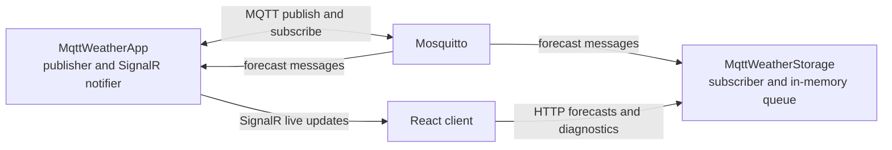
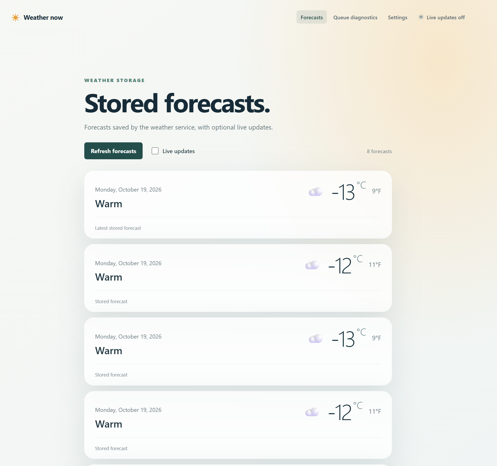
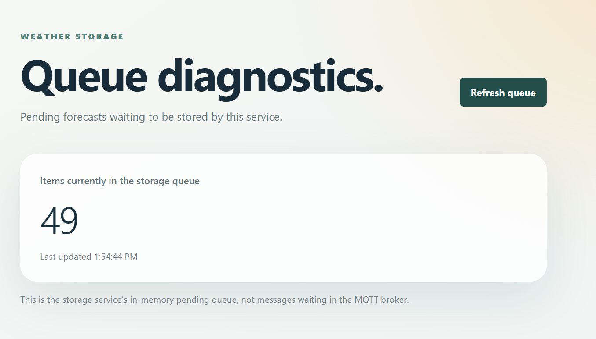

# MQTT Weather App

A small weather application for demonstrating how MQTT can connect a backend and a client. The app generates sample forecasts, publishes them through an MQTT broker, and makes them available to the web client.

## How it works



- **MqttWeatherApp** generates sample forecasts at a configurable interval, publishes them to the MQTT topic, and listens on that topic to broadcast forecasts to connected clients over SignalR.
- **MqttWeatherStorage** subscribes to the topic, places received forecasts in an in-memory queue, and stores them after a configurable processing delay. Its HTTP API serves the stored forecasts to the client.
- **Client** is a React and TypeScript web app. It displays stored forecasts, can receive live SignalR updates, and provides settings and queue diagnostics.
- **Mosquitto** is the MQTT broker used for communication between the backend services.

Forecasts and the storage queue are held in memory; they are cleared when the storage service restarts. The forecasts are generated sample data, not readings from a weather provider.

## Screenshots





## Run locally

### Prerequisites

- .NET 10 SDK
- Node.js and npm
- Docker with the Docker Compose plugin

### 1. Start the MQTT broker

Create `mqtt/.env` with credentials for the local broker:

```dotenv
MOSQUITTO_USERNAME=weather-app
MOSQUITTO_PASSWORD=replace-with-a-local-password
```

Keep this file local and do not commit real credentials. From the repository root, start Mosquitto:

```powershell
docker compose --env-file mqtt/.env -f mqtt/compose.yaml up -d
```

The broker listens on `localhost:1883`.

### 2. Start the backend services

Run each service in a separate PowerShell terminal from the repository root. Set the MQTT credentials to the same values used in `mqtt/.env`; both services require these settings.

For **MqttWeatherApp**:

```powershell
$env:Mqtt__Host = "localhost"
$env:Mqtt__Port = "1883"
$env:Mqtt__Username = "weather-app"
$env:Mqtt__Password = "replace-with-a-local-password"
$env:Mqtt__Topic = "weather/forecast"
dotnet run --project .\server\MqttWeatherApp\MqttWeatherApp\MqttWeatherApp.csproj --launch-profile http
```

For **MqttWeatherStorage**, open another terminal and set the same variables:

```powershell
$env:Mqtt__Host = "localhost"
$env:Mqtt__Port = "1883"
$env:Mqtt__Username = "weather-app"
$env:Mqtt__Password = "replace-with-a-local-password"
$env:Mqtt__Topic = "weather/forecast"
dotnet run --project .\server\MqttWeatherStorage\MqttWeatherStorage\MqttWeatherStorage.csproj --launch-profile http
```

The HTTP endpoints are:

- MqttWeatherApp: `http://localhost:5245`
- MqttWeatherStorage: `http://localhost:5031`

### 3. Start the web client

In a third terminal:

```powershell
cd .\client
npm install
$env:VITE_SIGNALR_HUB_URL = "http://localhost:5245/hubs/weatherforecast"
npm run dev
```

Open the URL printed by Vite (by default, `http://localhost:5173`). The client calls the backend services at the local URLs above.

## Settings and diagnostics

Open **Settings** in the client to enable or disable MQTT publishing and subscriptions and to change the forecast send interval or simulated storage delay. These runtime settings are kept in memory and reset when their service restarts. MQTT connection details, including the broker host, port, credentials, and topic, are configured through the backend's normal .NET configuration sources; the environment variables above override the values in `appsettings.json`.

Open **Queue diagnostics** to see how many forecasts are waiting in MqttWeatherStorage's in-memory processing queue. This is the application's pending queue, not messages waiting in Mosquitto. Use **Refresh queue** to request an updated count.

## Client development

From the `client` directory:

```powershell
npm run build
npm run lint
```
